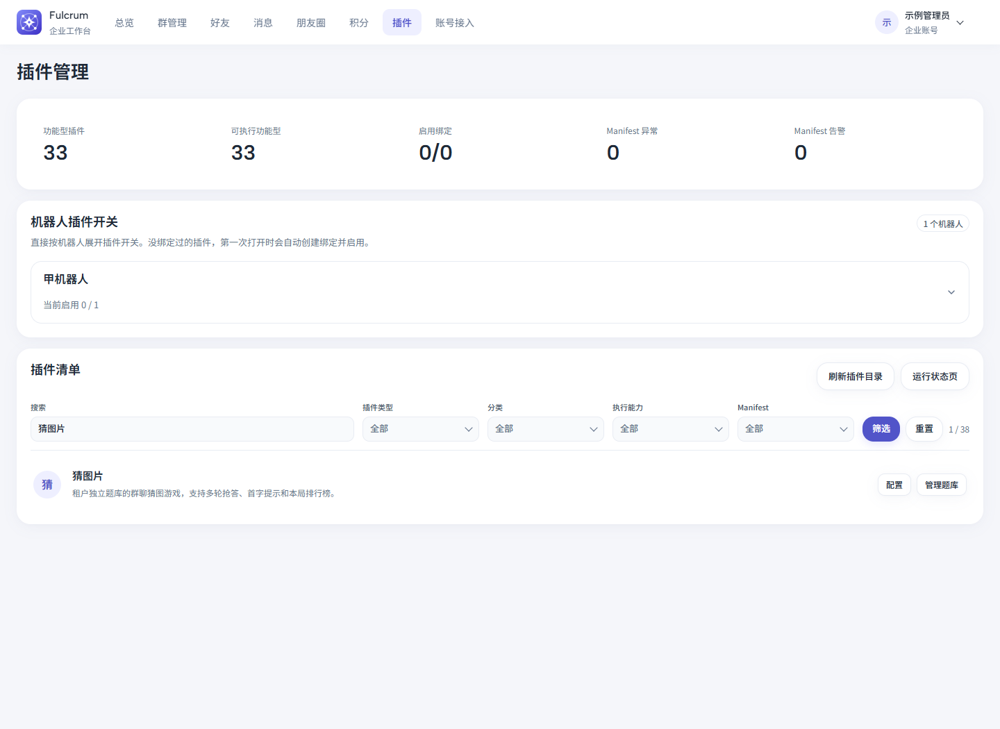
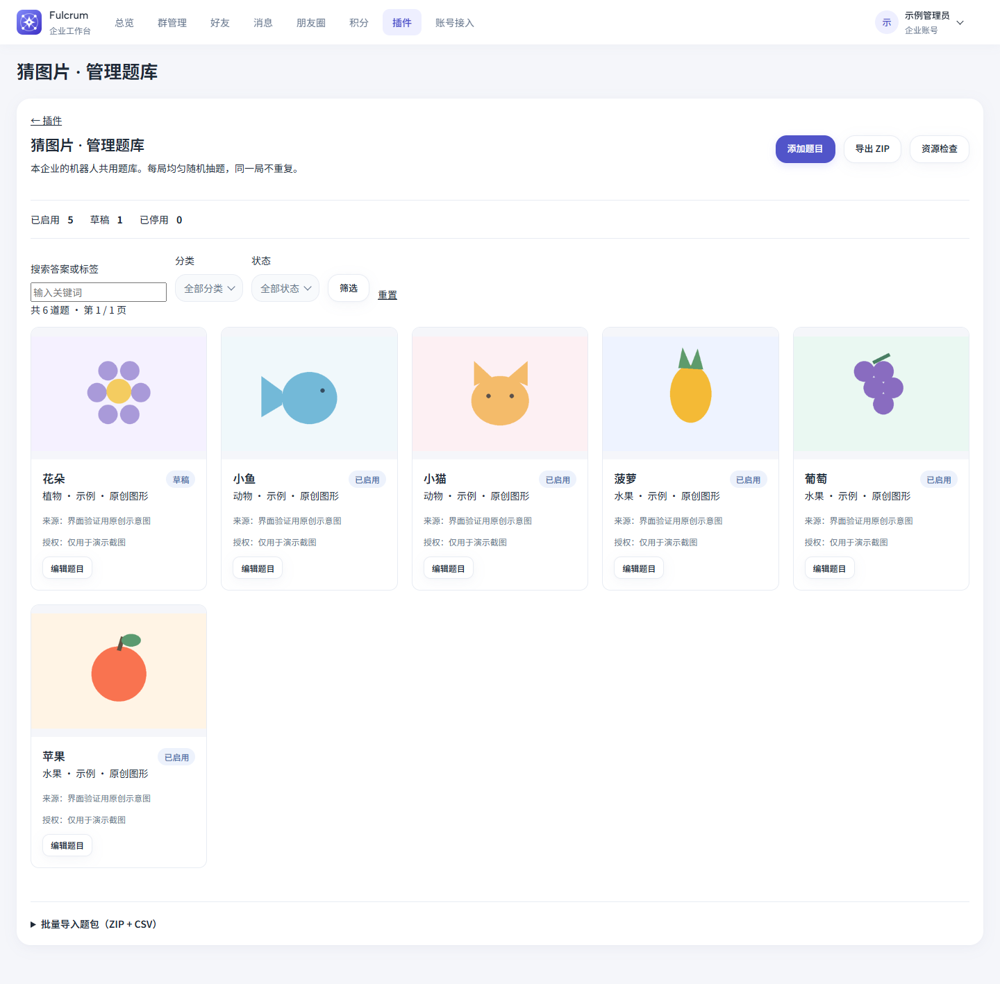

# 猜图片

群聊多轮猜图游戏，题库属于租户。同一租户的机器人共用题库，不同租户的题目、图片、导入记录和游戏状态相互隔离。插件默认关闭；绑定机器人后，还需要在受管群中启用。

## 使用

- `猜图片` / `guess-image`：开局，默认 5 题，每题 60 秒，剩余 30 秒时提示首字。
- 直接发送答案：仅匹配完全相同的纯文本，不忽略空格、大小写，不做模糊匹配、别名或引用回复匹配。
- 同一群同时一局；各群独立。先答对者得 1 分并进入下一题。超时公布答案；本题没有任何人类消息则提前结束。图片、语音和其他命令也算参与。
- 排行榜仅属于本局，同分按首次答对的先后排序。
- `猜图片 次数` / `猜图片次数`：查询今日使用情况。默认每群每天 5 次，北京时间零点重置。
- `猜图片 次数 10` / `猜图片 次数 0` / `猜图片 次数 默认`：仅本群群主、群管理员可调整，0 表示不限次。权限使用渠道同步的群成员身份，不使用后台员工角色。尚未同步群身份时应先同步成员。

**不保存题目历史出现次数、答对次数或权重，也不保存跨局排行榜。** 每局从已启用题目中等概率抽样，不放回；不足配置题数时不启动。仅保存每日配额和当前局所需状态。

## 题库后台

企业工作台 → 插件 → 猜图片 → **管理题库**（`/plugin-admin/guess_image`）。此按钮来自通用 `[admin]` 声明，普通插件保留原来的配置按钮。平台后台只负责既有的插件可用性与租户授权，不管理租户题目。

只读员工可查看题库；运营及以上可上传、编辑、替换、删除、导入、导出、检查资源。所有修改验证租户 CSRF。支持分类、标签、来源、授权、草稿/启用/停用、搜索筛选及分页。启用必须有来源和授权说明。

图片只接受真实可解码的静态 PNG/JPEG，单张 ≤ 5 MiB、400 万像素。内容哈希去重，原件和缩略图保存在 `DATA_DIR/tenants/{tenant_id}/plugins/guess_image/`。替换/删除题目不立即删除图片：进行中的游戏使用开局快照，避免管理操作破坏正在发出的题目。资源检查报告缺失和保留资源，不自动清理。

## 题包

ZIP 根目录 `questions.csv`（UTF-8，可有 BOM），图片放在 `images/`：

```csv
id,image,answer,category,tags,source,license,status
,images/apple.png,苹果,水果,红色|水果,https://example.org/original,CC0,draft
```

`id` 可空或为 UUID；已有 ID 跳过，绝不覆盖。标签用 `|` 分隔；状态为 `draft`、`enabled`、`disabled`，默认草稿。启用题目需要来源与授权；草稿可暂缺，便于导出后继续补全。导入分“校验预览”和“确认提交”，预览绑定当前租户、员工、登录会话，10 分钟有效；重复确认幂等。最大 ZIP 20 MiB、展开 80 MiB、1000 题/图片。拒绝穿越、符号链接、加密、重复路径、异常压缩比、坏 CRC、不合法编码、伪图片。导出保持同一格式。

私有素材不随插件代码或 PR 提交。可用 `scripts/guess_image_bank.py` 显式指定租户导入经过验证的题包；禁止猜测目标租户。管理界面同样可导入线上取得的包。新增素材时应确认来源、授权与使用范围。

```bash
python scripts/guess_image_bank.py /path/to/downloaded-bank.zip --tenant-id 123
python scripts/guess_image_bank.py /path/to/downloaded-bank.zip --tenant-id 123 --commit
```

第一条只校验；第二条才向明确指定的租户写入。请使用实际租户编号。

## 界面示例

截图使用虚构企业和原创示意图，不包含私有题库素材。




## 持久化和发送

游戏使用 `PluginStateRecord` 和现有插件调度/出站队列，无进程内定时器或独立线程。绑定行写锁串行仲裁开局、抢答和超时；消息收据、游戏 ID、轮次及任务幂等键防止重放/旧定时器重复结算。重启后任务继续从数据库执行。

计时从渠道确认图片成功后开始（队列确认检查间隔约 1 秒）。微桥等待手机结果，不能把“命令已入队”视为发送成功；需配置手机可访问的 `PUBLIC_BASE_URL`。120 秒内未确认或发送失败停止本局，首题尚未确认则返还已预留配额。外部渠道不能提供端到端 exactly-once；任务一旦已由手机领取，取消无法撤回实际发送。未领取的待发任务会取消，避免盲目重试发图。

停用绑定或取消群授权时现有框架阻止后续发送及定时执行；重新启用后，新的群指令会清退超期游戏。更新插件前运行 Alembic 到最新 revision。

## 来源

玩法参考 MIT 许可的 `koishi-plugin-guess-image`；本实现使用 Fulcrum 的租户认证、数据库和消息队列。没有复制旧版的历史统计和加权抽题。参考许可见 `NOTICE`。
